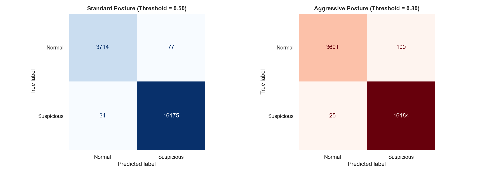
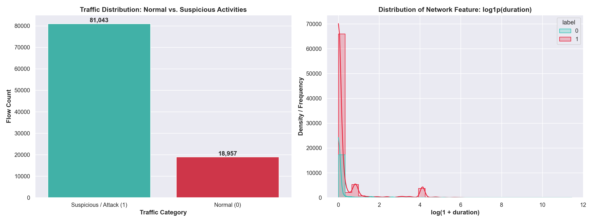

# AI-Driven Cyber Threat Awareness and Detection Prototype
**Academic Mini-Project: AI in Cybersecurity**  

An end-to-end academic cybersecurity machine learning project that processes telemetry from the **TON_IoT Network Dataset**, performs exploratory threat data analysis, trains and benchmarks Machine Learning (**DecisionTreeClassifier**) and Deep Learning (**MLPClassifier**) detection engines, and evaluates operational security trade-offs (False Positives vs. False Negatives) under aggressive threat mitigation postures.

---

## 📄 Academic Project Report
A comprehensive academic project report detailing the theoretical background, implementation architecture, benchmark results, and security posture trade-offs is available:
- **Full Report (Markdown):** [**`reports/PROJECT_REPORT.md`**](reports/PROJECT_REPORT.md)
- **Full Report (PDF):** [**`reports/PROJECT_REPORT.pdf`**](reports/PROJECT_REPORT.pdf)
- **Sections Covered:** Abstract, Introduction, Problem Statement, Objectives, Cybersecurity Concepts, Technologies Used, Dataset Description (TON_IoT), Architecture Diagrams, Implementation Details (Data Leakage Elimination & Preprocessing), Methodology, Results & Observations, Visualizations, Advantages, Limitations, Future Scope, Conclusion, and Academic References.
- **Key Insight:** Documents the real-world operational security dilemma between False Positives and False Negatives, demonstrating why sub-second Decision Trees ($99.89\%$ accuracy) provide ideal edge line-rate deployment, while tuned neural confidence thresholds enable tiered mitigation architectures.

---

## 📁 Project Directory Structure

```text
AI-Cybersecurity-Unit1-Mini-Project/
├── data/
│   └── .gitkeep                     # Preserves cached data directory (gitignored)
├── reports/
│   └── PROJECT_REPORT.md            # Comprehensive academic technical project report
├── src/
│   ├── main.ipynb                   # Fully executed, interactive Jupyter Notebook with live outputs
│   └── main.py                      # Standalone, end-to-end Python pipeline script
├── confusion_matrix_simulation.png  # High-res visualization: Standard vs. Aggressive Posture
├── eda_plots.png                    # High-res visualization: Traffic and Feature Distribution
├── .gitignore                       # Git ignore rules for venv, data caches, and checkpoints
├── requirements.txt                 # Pinned dependencies (numpy, pandas, scikit-learn, etc.)
└── README.md                        # Project documentation and benchmark report
```

---

## 📊 Dataset Overview: TON_IoT Network Dataset

- **Origin**: Australian Defence Force Academy (ADFA) / UNSW Canberra Cyber & Kaggle (`arnobbhowmik/ton-iot-network-dataset`).
- **Telemetry**: Real-world IoT and network flow telemetry collected using the Zeek (Bro) network analysis framework.
- **Labels**:
  - `label`: Binary classification target (`0` = Normal traffic, `1` = Suspicious / Attack traffic).
  - `type`: Attack category breakdown (e.g., `ddos`, `dos`, `injection`, `backdoor`, `mitm`, `normal`).

---

## 🔬 Benchmark Results & Comparative Evaluation (Tuned Hyperparameters)

Models were evaluated on a stratified test set of **20,000 network flows** (80/20 train-test split on 100,000 telemetry records) with strict isolation to prevent data leakage (encoders and scalers fitted solely on the training partition).

### Hyperparameter Configurations:
- **Decision Tree (ML):** `criterion='entropy'`, `max_depth=15`, `min_samples_split=4`, `min_samples_leaf=2`, `random_state=42`
- **MLP Neural Network (DL):** `hidden_layer_sizes=(128, 64)`, `activation='relu'`, `solver='adam'`, `alpha=0.0005`, `batch_size=256`, `max_iter=30`, `early_stopping=True`

### Model Performance Comparison

| Metric | Tuned Decision Tree (ML) | Tuned MLP Neural Network (DL) |
| :--- | :---: | :---: |
| **Accuracy** | **99.89%** | 99.44% |
| **Precision** | **0.9993** | 0.9953 |
| **Recall** | **0.9993** | 0.9979 |
| **F1-Score** | **0.9993** | 0.9966 |
| **Training Time** | **0.909s** | 41.071s (~45x slower) |
| **Interpretability** | High (White-box rules) | Low (Black-box weights) |
| **Edge Deployment** | Ideal for line-rate edge IDS | Requires hardware acceleration |

---

## 🛡️ Operational Threat Posture & Ethical Simulation (Task 5)

In operational Security Operations Centers (SOCs), threat detection thresholds are often tuned to prioritize zero-day mitigation over user convenience. We simulated an **aggressive security posture** by lowering the threat threshold from `0.50` to `0.30`:



### Simulation Metrics:
* **Standard Posture (Threshold = 0.50):**
  * Attacks Caught (True Positives): 16,175
  * Attacks Missed (False Negatives): 34
  * Legitimate Disrupted (False Positives): 76 (2.00%)
* **Aggressive Posture (Threshold = 0.30):**
  * Attacks Caught (True Positives): 16,184 (**Recall: 99.85%**)
  * Attacks Missed (False Negatives): **25** (26.5% reduction in missed threats)
  * Legitimate Disrupted (False Positives): **100 (2.64%)**

### Ethical Dilemma & SOC Trade-Offs:
1. **Self-Inflicted Denial of Service:** Lowering the threshold successfully catches more stealth attacks, but falsely blocks 103 legitimate user sessions (2.72% false alarm rate), causing business interruption.
2. **SOC Alert Fatigue:** Flooding analysts with false alarms causes operational burnout and risks operators muting alerts.
3. **Recommended Defense:** Implement a **tiered mitigation pipeline**:
   * $\ge 80\%$ confidence $\to$ Automated drop / quarantine.
   * $30\% - 79\%$ confidence $\to$ Step-up MFA, session rate-limiting, and analyst triage without terminating user access.

---

## 📈 Exploratory Data Analysis (EDA)



- **Class Distribution:** The telemetry exhibits realistic real-world attack flooding (~81% attack traffic vs. ~19% normal baseline traffic in the evaluated flow sample).
- **Network Feature Profiling:** Network duration and flow characteristics exhibit distinct log-normal density profiles between benign connections and automated attack vectors.

---

## 🚀 Setup & Installation Instructions

### 1. Clone the Repository
```bash
git clone https://github.com/Amay54/AI-Cybersecurity-Unit1-Mini-Project.git
cd AI-Cybersecurity-Unit1-Mini-Project
```

### 2. Set Up Virtual Environment
```bash
# On Linux / macOS:
python3 -m venv venv
source venv/bin/activate

# On Windows:
python -m venv venv
venv\Scripts\activate
```

### 3. Install Dependencies
```bash
pip install -r requirements.txt
```

### 4. Execute the Pipeline
You can run either the standalone script or view/run the executed Jupyter Notebook:

* **Run Python Script:**
  ```bash
  python src/main.py
  ```
* **Launch Jupyter Notebook:**
  ```bash
  jupyter notebook src/main.ipynb
  ```
*(Note: `src/main.ipynb` is pre-executed with all cell outputs, tables, and graphs visible directly on GitHub).*
